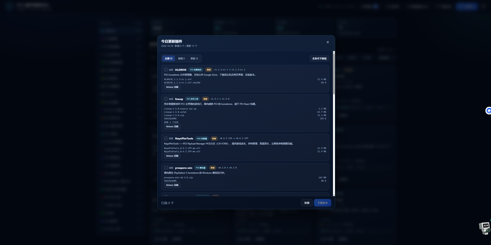
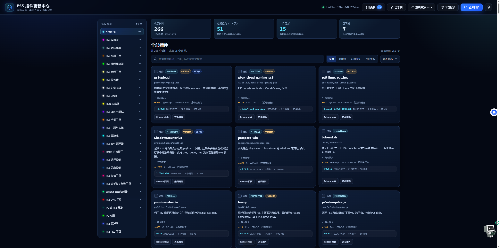
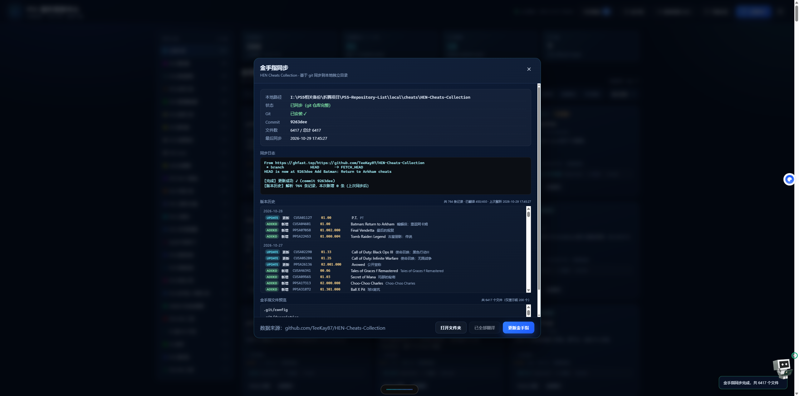
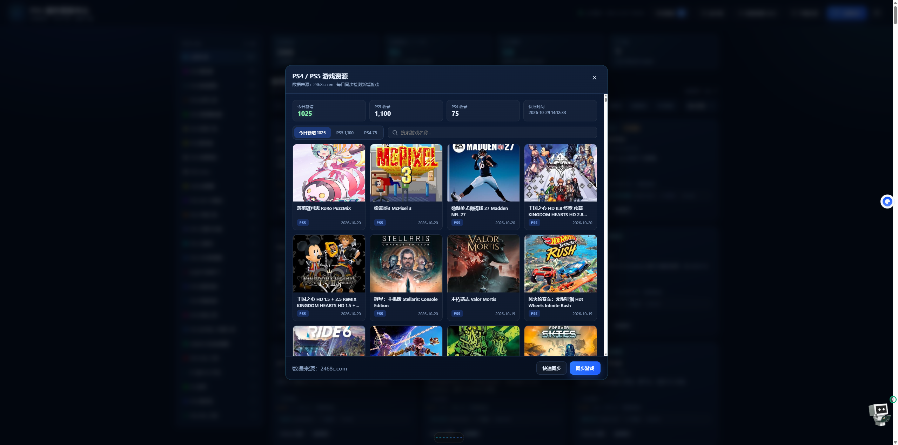
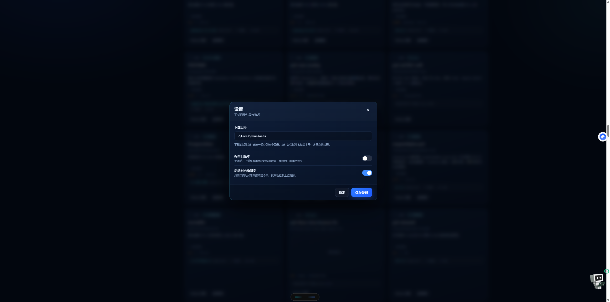

# PS5-Toolkit

> **项目来源声明**
>
> 本项目 **基于 [nexgen999/PS5-Repository-List](https://github.com/nexgen999/PS5-Repository-List) 改造开发**。
> 原作者：[@nexgen999](https://github.com/nexgen999)。原始仓库未附带 LICENSE 文件，本项目授权条件沿用上游仓库；如需商用请先向上游作者确认授权。

## 项目简介

PS5-Toolkit 是一个**完全本地运行**的 PS5 资源管理工具。它在你自己电脑上启动一个轻量 Node.js 服务（默认 `http://127.0.0.1:8123`），用浏览器打开即是中文控制台，把「插件仓库浏览 / 每日更新 / 按需下载 / 金手指同步 / 游戏资源追踪」收在一个页面里。

不依赖第三方服务、不需要登录账号、不上传任何数据。所有运行状态与下载记录保存在本地 `local/state/`，删除该目录即彻底清除。

## 下载安装

前往 **[Releases](https://github.com/liweili/PS5-Toolkit/releases/latest)** 下载：

| 文件 | 大小 | 说明 |
|---|---|---|
| `PS5-Plugin-Hub-Setup.exe` | 32.7 MB | **安装版**，带桌面快捷方式，推荐普通用户 |
| `PS5-Plugin-Hub.exe` | 32.7 MB | **便携版**，免安装，双击即用 |
| `PS5-Plugin-Hub.zip` | 1.6 MB | **脚本版**，解压后运行 `local\start.ps1`，适合查看/修改源码 |

> 系统要求：Windows 10 / 11 + Node.js 18+（Git 可选，未安装时自动改用 GitHub 直连下载）。

## 界面预览

**① 今日插件更新** — 只列出当天新增与版本变化的插件，显示版本号对比与文件大小，可直接勾选下载



**② 首页效果** — 分类侧栏 + 统计卡片 + 插件卡片网格，支持关键词搜索与多字段排序



**③ 金手指更新及记录显示** — 数据来源 [TeeKay87/HEN-Cheats-Collection](https://github.com/TeeKay87/HEN-Cheats-Collection)，含 Git 提交记录、版本历史与中文对照



**④ PS4 / PS5 游戏显示及下载路径** — 数据来源 [2468c.com](https://2468c.com)，今日新增独立展示，点击卡片直达游戏详情页



**⑤ 设置** — 自定义下载路径；金手指通过 Git 拉取到本地，下载文件同样保存到本地并按规则命名



## 具体功能

### 1. 插件仓库中心

- 汇总 PS5 生态主流 GitHub 仓库（homebrew、模拟器、开发工具、实用程序），按类别分组着色展示
- 每个条目显示名称、作者、简介、Star 数、最新版本、更新时间、下载入口
- 支持分类筛选、关键词搜索、多字段排序
- 插件简介与分类做全量中文翻译（原版为法语界面），未翻译项自动回退原文

### 2. 每日更新与变更识别

- 每日 **09:00** 自动同步上游（`local/run-daily.ps1`），也可在界面手动点击「同步」
- 同步时逐项比对仓库元数据，识别**新增插件**与**版本更新**并写入快照
- 首次打开页面自动弹出「**今日更新**」弹窗，只列出当天有变动的条目
- 后台有实时日志输出，失败自动重试；同步失败不会破坏已有数据

### 3. 按需下载

- 按条目勾选下载，只取需要的文件，不做全量拉取
- 支持单个插件多文件（主程序 + 依赖 + 配置）
- **断点续传**（HTTP Range），大文件中途断网可续
- 下载前自动清理同名旧版本，避免目录堆积
- 记录**下载历史**，可回溯下过的条目与版本
- 一键在资源管理器中打开下载目录或指定文件

### 4. 金手指（[HEN Cheats Collection](https://github.com/TeeKay87/HEN-Cheats-Collection)）

- 通过 Git 将 [TeeKay87/HEN-Cheats-Collection](https://github.com/TeeKay87/HEN-Cheats-Collection) 拉取到本地，按游戏名建立索引
- 保留**版本历史**，可查看单个游戏的历次更新
- 提供金手指内容的**中文翻译**对照
- 一键打开金手指目录，方便拷贝到 U 盘

### 5. PS4 / PS5 游戏资源追踪

- 抓取资源站 `2468c.com` 的 [PS5 列表](https://2468c.com/ps5game) 与 [PS4 列表](https://2468c.com/ps4) 全部分页
- 处理站点 Cookie 握手（首次 403 → 取 Cookie → 重发），带三次重试与指数退避
- 与本地快照对比，**自动识别每天新增的游戏**并按日期归档
- 界面三个标签页：**今日新增 / PS5 / PS4**，今日新增条目高亮显示
- 卡片展示封面图、中文标题、平台徽章、发布时间，支持搜索过滤
- 点击任意卡片直接打开该游戏独立详情页（`https://2468c.com/{id}.html`）
- 提供「快速同步」（只抓前几页，适合每日检测）与「全量同步」两种模式
- 抓取失败不清空已有快照，保证数据安全

### 6. 工程与打包

- 纯 Node.js 实现，**零第三方运行时依赖**，无需 `npm install`
- 前端为原生 HTML / CSS / JS，无框架、无构建步骤
- 响应式布局，手机 / 平板 / 桌面均可使用
- PowerShell 安装脚本自动检测 Node.js / Git，缺失时引导安装
- Electron 安装包构建脚本，产出可分发的 `PS5-Plugin-Hub.zip` 与桌面快捷方式

## 与原版差异

| 维度 | 原版 nexgen999/PS5-Repository-List | 本项目 PS5-Toolkit |
|---|---|---|
| 界面语言 | 法语 | 全中文（字段级翻译） |
| 部署形态 | 静态页 + 定时脚本 | 本地 Node.js 服务 + 浏览器控制台 |
| 下载方式 | 跳转链接 | 页内勾选、断点续传、旧版清理、下载历史 |
| 更新提醒 | 无 | 今日更新弹窗 + 新增/更新识别 |
| 金手指 | 无 | HEN Cheats 同步 + 版本历史 + 翻译 |
| 游戏资源 | 无 | PS4/PS5 抓取 + 每日新增独立展示 |
| 安装分发 | 源码使用 | PowerShell 安装器 + Electron 打包 |

## 安装（Windows）

1. 下载最新 Release 中的 `PS5-Plugin-Hub.zip`
2. 解压到任意目录
3. 右键 `install.ps1` → **使用 PowerShell 运行**
   - 若提示执行策略限制，先在 PowerShell 中运行：

     ```powershell
     Set-ExecutionPolicy -Scope CurrentUser RemoteSigned
     ```

4. 安装脚本自动检测 Node.js（必需）与 Git（推荐），缺失时打开官方下载页
5. 安装完成后桌面生成「PS5 插件更新中心」快捷方式，双击启动

### 系统要求

- **Node.js** 18+（必需，用于运行本地服务）
- **Git**（推荐，同步更快；未安装时自动改用 GitHub 直连下载）
- Windows 10 / 11

## 从源码构建安装包

```powershell
cd dist
powershell -ExecutionPolicy Bypass -File build-installer.ps1
```

生成 `dist/PS5-Plugin-Hub.zip`，上传到 GitHub Release 即可分发。

## 目录结构

```
local/
├── scripts/
│   ├── server.js       本地 HTTP 服务与 API
│   ├── sync.js         插件仓库同步
│   └── sync-games.js   PS4/PS5 游戏资源同步
├── site/               前端页面与数据（index.html / app.js / styles.css）
├── i18n/               中文翻译
├── state/              运行时状态（同步结果、下载记录、快照）
├── config.json         配置文件
├── start.ps1           启动脚本
└── run-daily.ps1       每日定时任务
```

## 许可

本项目本地化与功能扩展部分遵循上游仓库的授权条件。原始架构与设计版权归 [@nexgen999](https://github.com/nexgen999) 所有。
