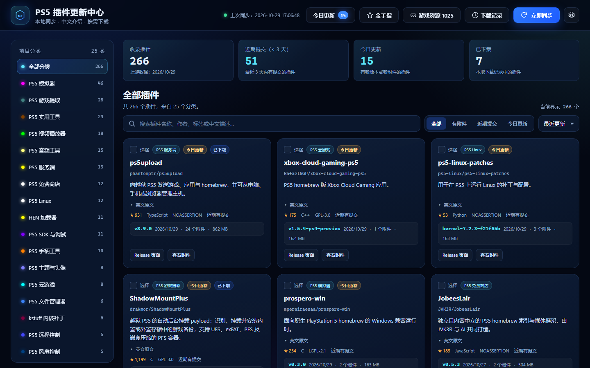
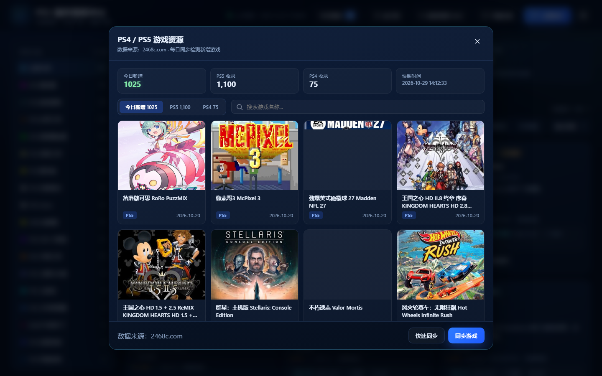
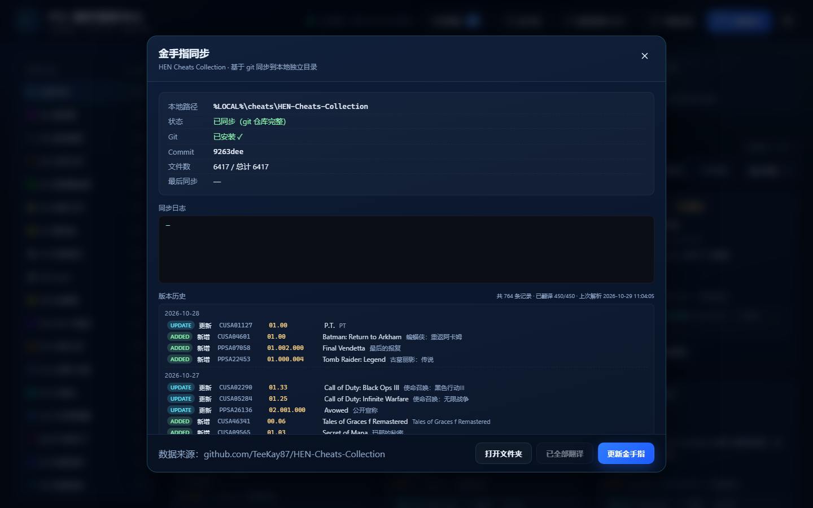

# PS5-Toolkit

> **⚠️ 项目来源声明 / Attribution**
>
> 本项目 **基于 [nexgen999/PS5-Repository-List](https://github.com/nexgen999/PS5-Repository-List) 改造开发**。
>
> 原作者：[@nexgen999](https://github.com/nexgen999)。原始仓库未附带 LICENSE 文件，本项目在其基础上进行中文本地化与功能扩展，授权条件沿用上游仓库；如需商用请先向上游作者确认授权。
>
> 中文说明见 [README-zh.md](./README-zh.md)。

---

## 🇨🇳 项目简介

PS5-Toolkit 是一个**完全本地运行**的 PS5 资源管理工具。它在你自己电脑上启动一个轻量 Node.js 服务（默认 `http://127.0.0.1:8123`），用浏览器打开即是一个中文控制台，把「插件仓库浏览 / 每日更新 / 按需下载 / 金手指同步 / 游戏资源追踪」全部收在一个页面里。

不依赖任何第三方服务、不需要登录账号、不上传任何数据；所有状态与下载记录都保存在本地 `local/state/`，删掉目录即彻底清除。

### 界面预览

**主界面 · 插件仓库中心**（分类侧栏 + 统计卡片 + 插件卡片网格）



**今日更新 · 只列出当天新增与版本变化的条目，可直接勾选下载**


**PS4 / PS5 游戏资源 · 今日新增独立展示，点击卡片直达游戏详情页**



**金手指同步 · HEN Cheats 版本历史与中文对照**



### 具体功能

**1. 插件仓库中心（核心）**

- 汇总 PS5 生态主流 GitHub 仓库（homebrew、模拟器、开发工具、实用程序），按类别分组着色展示
- 每个插件显示：名称、作者、简介、Star 数、最新版本、更新时间、下载入口
- 支持**分类筛选 + 关键词搜索 + 多字段排序**
- 插件简介与分类做了**全量中文翻译**（原版为法语界面），字段级对照翻译，未翻译项自动回退原文

**2. 每日更新与变更识别**

- 每日 **09:00** 自动同步上游（`local/run-daily.ps1` 计划任务），也可在界面手动点「同步」
- 同步时逐个比对仓库元数据，识别**新增插件**与**版本更新**，写入快照
- 首次打开页面自动弹出「**今日更新**」弹窗，只列出当天有变动的条目，一眼看到新增了什么
- 同步过程有实时日志输出，失败自动重试，失败不会破坏已有数据

**3. 按需下载**

- 不是一股脑全量下载，而是**按条目勾选**，只取你需要的文件
- 支持一个插件多文件（主程序 + 依赖 + 配置）
- **断点续传**（HTTP Range），大文件中断可恢复
- 下载前自动清理旧版本文件，避免目录堆积
- 记录**下载历史**，可回溯曾经下过什么、下到哪个版本
- 支持一键在资源管理器中**打开下载目录 / 打开指定文件**

**4. 金手指（HEN Cheats Collection）**

- 同步 HEN 金手指合集仓库，按游戏名建立索引
- 保留**版本历史**，可查看某游戏金手指的历次更新
- 提供金手指文件的**中文翻译**能力（调用翻译接口生成对照）
- 一键打开金手指所在目录，方便拷贝到 U 盘

**5. PS4 / PS5 游戏资源追踪（本项目新增）**

- 抓取资源站 `2468c.com` 的 [PS5 列表](https://2468c.com/ps5game) 与 [PS4 列表](https://2468c.com/ps4) 全部分页
- 处理站点 Cookie 握手（首次 403 → 取 Cookie → 重发），带**三次重试 + 指数退避**
- 与本地快照对比，**自动识别每天新增的游戏**，按日期归档
- 界面三个标签页：**今日新增 / PS5 / PS4**，今日新增条目高亮
- 卡片展示封面图、中文标题、平台徽章、发布时间；支持搜索过滤
- 点击任意卡片**直接打开该游戏的独立详情页**（`https://2468c.com/{id}.html`）
- 提供「快速同步」（只抓前几页，适合每日检测）与「全量同步」两种模式
- 抓取失败不清空已有快照，保证数据安全

**6. 工程与打包**

- 纯 Node.js 实现，**零第三方运行时依赖**（无需 npm install）
- 前端为原生 HTML/CSS/JS，无框架、无构建步骤
- 响应式布局，手机 / 平板 / 桌面均可正常使用
- 提供 PowerShell 安装脚本，自动检测 Node.js / Git，缺失时引导安装
- 提供 Electron 安装包构建脚本，产出可分发的 `PS5-Plugin-Hub.zip` 与桌面快捷方式

### 与原版的差异一览

| 维度 | 原版 nexgen999/PS5-Repository-List | 本项目 PS5-Toolkit |
|---|---|---|
| 界面语言 | 法语 | 全中文（字段级翻译） |
| 部署形态 | 静态页 + 定时脚本 | 本地 Node.js 服务 + 浏览器控制台 |
| 下载方式 | 跳转链接 | 页内勾选、断点续传、旧版清理、下载历史 |
| 更新提醒 | 无 | 今日更新弹窗 + 新增/更新识别 |
| 金手指 | 无 | HEN Cheats 同步 + 版本历史 + 翻译 |
| 游戏资源 | 无 | PS4/PS5 抓取 + 每日新增独立展示 |
| 安装分发 | 源码使用 | PowerShell 安装器 + Electron 打包 |

---

## 🇬🇧 Attribution

This project is **based on and modified from [nexgen999/PS5-Repository-List](https://github.com/nexgen999/PS5-Repository-List)** by [@nexgen999](https://github.com/nexgen999). All credit for the original architecture and design goes to the original author.

**What this project changes:** full Chinese localization (the original UI is French), a local Node.js server with a browser-based console, selective resume-capable downloads with download history, daily update detection with a "today's changes" popup, HEN Cheats Collection sync with version history, and daily new-game tracking for PS4/PS5 game resources.

---

## 原始项目说明（Français · 原文保留）

**PS5 Repository List** — Bienvenue sur le dépôt **PS5 Repository List**, une plateforme centralisée et automatisée conçue pour suivre, organiser et présenter les dépôts GitHub essentiels de l'écosystème PS5 (homebrews, émulateurs, outils de développement et utilitaires).

---

## 🌟 Vue d'ensemble du projet

Le projet s'articule autour de plusieurs composants clés :
1. **La configuration des sources (`repos-config.json`)** : La liste brute de vos dépôts classés par catégories et couleurs.
2. **Le script de mise à jour (`update-db.js`)** : Un script automatisé (exécuté localement ou via GitHub Actions) qui interroge l'API GitHub pour récupérer les dernières métadonnées de chaque dépôt (étoiles, dernière version, description, etc.).
3. **La base de données générée (`repos-database.json`)** : Le fichier final enrichi et prêt à être consommé par l'interface.
4. **L'interface Web (`index.html`)** : Le tableau de bord visuel permettant aux utilisateurs de naviguer, trier et rechercher parmi tous les outils répertoriés.
5. **Le gestionnaire de configuration graphique (`tools/config_manager.py`)** : Une application de bureau pour administrer facilement le fichier de configuration sans manipuler directement le JSON.

---

## 📂 Structure du dépôt

```text
├── .github/
│   └── workflows/
│       └── update-db.yml      # Workflow GitHub Actions (mise à jour automatique toutes les heures)
├── json/
│   ├── repos-config.json      # Fichier source contenant la liste des URLs et des catégories
│   └── repos-database.json    # Base de données finale générée et mise à jour automatiquement
├── scripts/
│   └── update-db.js           # Script Node.js de récupération des données GitHub
├── tools/
│   └── config_manager.py      # Application graphique Python (Tkinter) pour gérer la config
├── index.html                 # Interface utilisateur web principale
└── README.md                  # Documentation du projet
```

---

## 💻 Description des composants

### 1. L'interface HTML (`index.html`)
L'interface web sert de vitrine au projet. Elle charge dynamiquement le fichier `repos-database.json` pour afficher :
* Une barre de recherche en temps réel pour filtrer les projets.
* Un affichage par cartes (cards) regroupées par catégories visuelles.
* Des badges pour les étoiles GitHub, les versions, et les liens directs vers les dépôts.
* Un design moderne et responsive (adapté mobile et bureau).

### 2. Les fichiers JSON (`json/`)
* **`repos-config.json`** : C'est le fichier source que vous éditez. Il définit les **catégories** (avec leur identifiant, nom et couleur d'affichage) et la liste des **dépôts** (URL GitHub et catégorie associée).
* **`repos-database.json`** : Généré automatiquement, il contient les informations enrichies (statistiques, derniers commits, releases) prêtes à être affichées par le site web.

### 3. Les scripts et workflows
* **`scripts/update-db.js`** : Script Node.js qui lit le fichier de configuration, interroge l'API GitHub (avec gestion des tokens si nécessaire pour éviter les limites de taux) et met à jour la base de données.
* **GitHub Actions (`update-db.yml`)** : Un automatisme configuré pour lancer le script de mise à jour **toutes les heures** de manière autonome. Si des données changent, un commit est automatiquement effectué sur le dépôt.

---

## 🛠️ Utilisation de l'outil de gestion (`tools/config_manager.py`)

Pour vous faciliter la vie et éviter les erreurs de syntaxe dans le fichier JSON, une application de bureau a été placée dans le dossier `tools/`.

### Prérequis
* Python 3 installé sur votre machine.

### Lancement de l'outil
Depuis la racine du projet, lancez la commande suivante :

```bash
python tools/config_manager.py
```

### Fonctionnalités de l'outil :
* **Onglet Catégories** : Ajoutez, modifiez ou supprimez des catégories et personnalisez leur code couleur hexadécimal à l'aide d'un sélecteur visuel.
* **Onglet Dépôts** : Ajoutez de nouveaux liens GitHub, associez-les aux catégories existantes via un menu déroulant, modifiez ou supprimez des entrées en un clic.
* **Sauvegarde centralisée** : Un bouton global permet d'écrire instantanément les modifications dans `json/repos-config.json`.
